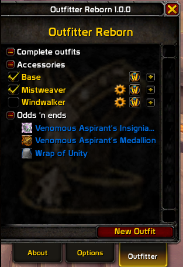
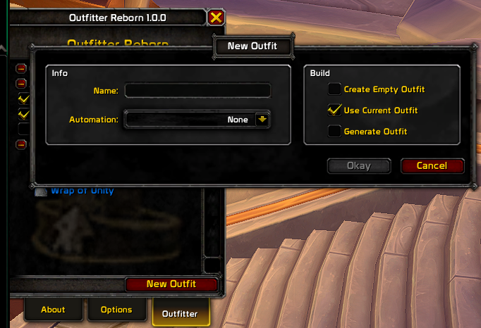
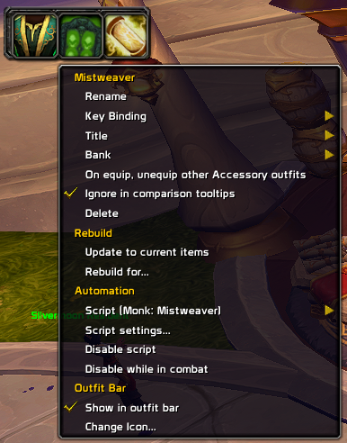
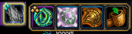
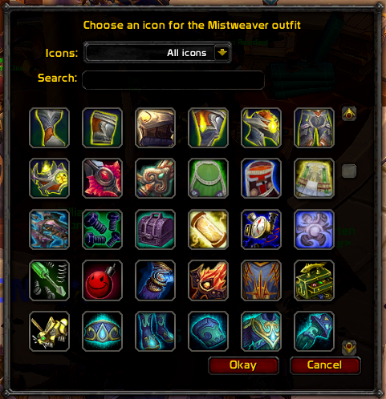

# Outfitter Reborn — user manual

Outfitter Reborn manages your gear. You build named outfits, and it puts them on
when you ask or when something happens that you told it to watch for.

This manual covers version 1.0.0, for WoW Midnight 12.1.

- [Installing](#installing)
- [Opening the window](#opening-the-window)
- [Outfit categories](#outfit-categories)
- [Creating an outfit](#creating-an-outfit)
- [Choosing which slots an outfit owns](#choosing-which-slots-an-outfit-owns)
- [Updating an outfit](#updating-an-outfit)
- [Automatic switching](#automatic-switching)
- [Battleground and arena outfits](#battleground-and-arena-outfits)
- [The outfit bar](#the-outfit-bar)
- [The minimap button](#the-minimap-button)
- [QuickSlots](#quickslots)
- [Bank storage](#bank-storage)
- [Building an outfit from stats](#building-an-outfit-from-stats)
- [Key bindings](#key-bindings)
- [Slash commands](#slash-commands)
- [Writing your own scripts](#writing-your-own-scripts)
- [What no longer works](#what-no-longer-works)

## Installing

Copy the `Outfitter` folder into `World of Warcraft\_retail_\Interface\AddOns`.
The folder must be named `Outfitter`, and it must contain `Outfitter.toc`
directly — if your unzip tool produced a folder inside a folder, use the inner
one.

Quit the game completely before installing an update. Not `/reload`, not a
character logout — all the way out to the desktop. WoW reads an addon's `.toc`
file once at startup and never looks at it again, so an update that adds or
removes a file will half-load if you install it with the game open. You get Lua
errors, outfits that refuse to switch and a UI in pieces. It isn't broken; a real
restart clears all of it.

## Opening the window

Open your character sheet, normally the `c` key. Outfitter adds a button with a
robe icon near the top right of that window; click it to open and close the
outfit list.

You can also open it from the minimap button, the addon compartment at the top of
the minimap, or a LibDataBroker display if you use one.

## Outfit categories



The list groups your outfits into two categories you create, and three it
generates for you.

**Complete outfits** specify every slot. Wearing one replaces everything else you
have on. This is the category for "my healing gear" or "my transmog set".

**Accessories** specify only some slots. They layer on top of whatever complete
outfit you're wearing, and you can wear as many at once as you like — a fishing
pole, a tabard, a trinket you swap in. Which category an outfit lands in is
decided automatically from how many slots it owns, so an accessory that grows to
cover every slot becomes a complete outfit on its own.

Below those, three lists are generated rather than built:

- **Odds 'n ends** — soulbound items in your bags that no outfit uses.
- **Unopened** — items still in their bind-on-equip state.
- **Warbound until equipped** — items that are still warbound.

These are there so you can find gear you forgot about. You can't edit them.

## Creating an outfit

Click **New Outfit** at the bottom of the list.



You can start from what you're wearing, from an empty outfit, or from a set of
stat weights (see [Building an outfit from
stats](#building-an-outfit-from-stats)). Name it and it appears in the list.

## Choosing which slots an outfit owns

This is the part that makes accessories work, and it's easy to miss.

Select an outfit in the list, then look at your character sheet. Outfitter puts a
checkbox beside every equipment slot. A ticked slot belongs to the outfit; an
unticked one is left alone when the outfit is equipped.

**Enable all** and **Enable none** above the slots tick and untick everything at
once. A green tick means Outfitter can see the item currently in that slot; a
question mark means the slot is part of the outfit but the item isn't findable
right now — it might be in the bank, or on another character.

Drag an item onto a checkbox to put that item in the slot directly.

## Updating an outfit

Wear whatever you want the outfit to become, select the outfit, and use
**Update** from its menu — or `/outfitter update outfitname`. Only the slots the
outfit owns are updated.

Equipping an item while an outfit is selected adds that item to the outfit.

## Automatic switching

An outfit can carry a script that equips and unequips it when something happens.
About sixty ready-made scripts ship with the addon, and you pick one from a menu
rather than writing anything:

| Kind | Examples |
| --- | --- |
| Professions | Herbalism, Mining, Skinning, Fishing, Cooking |
| Movement and state | Resting, Swimming, Mounted, Falling, Low health |
| Class | Druid forms, rogue Stealth, shaman Ghost Wolf, mage Evocation, hunter Feign Death |
| PvP | Any battleground, any arena, and one per map |
| Other | Dining, Spellcast, Has buff, Pet battle, Quest turn-in |



Choose one from the outfit's menu, fill in whatever settings it asks for, and it
starts working. `/outfitter disable` stops every script at once; `/outfitter
enable` starts them again.

## Battleground and arena outfits

Outfitter Reborn recognizes every battleground and arena in the game, and you can
have a general battleground outfit plus one for a specific map. The specific one
layers over the general one.

Detection reads the instance's map ID rather than the zone's name, so it works
regardless of what language you play in, and it copes with the maps Blizzard
re-issued under a second ID — Arathi Basin has four, and Warsong Gulch, Eye of
the Storm, Deepwind Gorge, Blade's Edge and Nagrand have two each.

If a battleground outfit isn't firing, `/outfitter zone` prints the instance type,
the map ID and which zone outfits Outfitter thinks apply. That map ID is the
useful thing to include in a bug report.

## The outfit bar



A movable bar of outfit icons for one-click switching, in a choice of sizes. Turn
it on in Options, drag it where you want it, and `/outfitter reset bar` puts it
back if it ends up somewhere unreachable.

Each outfit picks its own icon, chosen from the whole icon set:



## The minimap button

Left-click opens the settings panel. Right-click opens a short menu: turn the
addon on or off, lock the outfit bar, try test mode, show the outfit window, or
open the settings or the skin picker. Hovering it shows the outfit you're
wearing. Switching outfits lives on the outfit bar, the window, `/of wear` and the
key bindings. Hide the button from the General page if you'd rather use a
LibDataBroker display.

## QuickSlots

Hovering an equipment slot on the character sheet shows the other items you own
that fit it, so you can swap a single piece without editing an outfit.

## Bank storage

With the bank open, an outfit's menu can deposit it, withdraw it, or deposit
everything except the outfit you're wearing. `/outfitter depositunique` deposits
an outfit but keeps back anything another outfit still needs.

Void storage transfer no longer works — see [What no longer
works](#what-no-longer-works).

## Building an outfit from stats

Outfitter can assemble an outfit for you. Choose a stat, or a combination of
stats, and it searches your gear for the best set it can make. If you have
[Pawn](https://www.curseforge.com/wow/addons/pawn) installed, you can use one of
your Pawn scales instead of picking stats by hand.

## Key bindings

There are 14 bindings, in a section named after the addon in WoW's own Key
Bindings window and on the Keybindings tab of the General settings page:

- **Toggle outfit window**
- **Wear outfit 1** to **Wear outfit 10**. Give an outfit one of the ten keys from
  its menu. A Complete outfit is put on; any other outfit is put on, or taken off
  if you're wearing it. A second press within 0.75 seconds is ignored.
- **Turn on automatic outfit changes** and **Turn off automatic outfit changes**
- **Update outfit to equipped items**, which saves what you're wearing into the
  current Complete outfit

A wear key says "Hat equipped" on screen unless you turn off **Announce outfit
changes from key bindings**. Keys you bound in the old Outfitter don't carry over.

## Slash commands

`/of help` lists these in-game, and `/outfitter` is an alias for `/of`. An outfit
name is matched without regard to case; leave it out and the command uses the
Complete outfit you're wearing. A name may also be a macro conditional:
`/of wear [spec:1] Tank; DPS` wears Tank on your first specialization and DPS on
any other. While the addon is turned off, the commands that change gear answer
with one line saying how to turn it back on.

| Command | Effect |
| --- | --- |
| `/of help` | List the commands |
| `/of config` | Open the settings panel (`/of` alone does the same) |
| `/of skin` | Choose a skin |
| `/of enable` | Turn the addon on |
| `/of disable` | Turn the addon off without unloading it |
| `/of list` | List every setting |
| `/of get <setting>` | Read one setting |
| `/of set <setting> <value>` | Write one setting |
| `/of reset <setting>` | Reset one setting to its default |
| `/of resetall` | Reset every setting (asks first) |
| `/of debug` | Open the debug console; `on` and `off` turn logging on and off |
| `/of diagnostics` | Write the diagnostics report to the debug console |
| `/of perf` | Run a performance capture |
| `/of version` | Print the addon version |
| `/of show` | Show the outfit window on the character sheet |
| `/of hide` | Hide the outfit window |
| `/of wear [outfit]` | Wear an outfit |
| `/of unwear [outfit]` | Take an outfit off |
| `/of toggle [outfit]` | Wear it, or take it off if it's on |
| `/of update [outfit]` | Update an outfit to the items you have equipped |
| `/of deposit [outfit]` | Put an outfit's items in the bank (bank open) |
| `/of depositunique [outfit]` | Put in the bank only the items no other outfit uses |
| `/of depositothers [outfit]` | Put every other outfit's items in the bank |
| `/of withdraw [outfit]` | Take an outfit's items out of the bank |
| `/of withdrawothers [outfit]` | Take every other outfit's items out of the bank |
| `/of missing` | List the outfit items you no longer have (bank open) |
| `/of unequip <item or slot number>` | Move one equipped item to your bags |
| `/of updatetitle` | Re-apply the title of the outfit you're wearing |
| `/of auto [on\|off]` | Turn automatic outfit changes on or off; no word shows the state |
| `/of zone` | Show the instance, its zone outfits and the equipment updates' state |
| `/of iteminfo <item link>` | Print what the addon reads from an item link |
| `/of test` | Show sample outfits on the outfit bar |
| `/of lock` | Lock the outfit bar in place |
| `/of unlock` | Unlock the outfit bar to move it |
| `/of deleteall` | Delete every outfit on this character (asks first) |

Some old commands changed:

| Old | Now |
| --- | --- |
| `/outfitter sound on\|off` | `/of set equip.muteSounds false\|true` |
| `/outfitter errors on\|off` | `/of set equip.showErrors true\|false` |
| `/outfitter reset bar` | `/of reset bar.position` |
| `/outfitter reset` | `/of deleteall` |
| `/outfitter enable` and `disable` (automation) | `/of auto on` and `/of auto off` |
| `/outfitter summary`, `rating`, `itemstats` | removed |
| `/unequip` | `/of unequip` |

## Writing your own scripts

Scripts are Lua. Outfitter runs yours whenever one of the events it declares
fires, and your job is to set `equip` to say what should happen.

A script starts with directive comments:

```lua
-- $EVENTS PLAYER_ENTERING_WORLD PLAYER_UPDATE_RESTING
-- $DESC Equips the outfit while you are resting in an inn or a city
-- $SETTING minLevel = {type = "number", label = "Minimum level"}

if IsResting() then
    equip = true
else
    equip = false
end
```

`$EVENTS` lists what wakes the script. You can use any real WoW event, plus the
addon's own events below. `$DESC` is the description shown in the menu.
`$SETTING` declares an input the user can fill in, which arrives as a field on
`setting`.

### Variables available to a script

| Name | Meaning |
| --- | --- |
| `event` | The event that fired |
| `...` | The event's arguments |
| `outfit` | The outfit the script belongs to |
| `isEquipped` | True if the outfit is currently on |
| `didEquip` | True if this script is why it's on |
| `didUnequip` | True if this script is why it's off |
| `setting` | The values of the script's `$SETTING` inputs |
| `time` | The current time, as `GetTime()` |
| `equip` | Set `true` to equip, `false` to unequip, leave unset to do nothing |
| `layer` | Tag the outfit with a layer, so outfits sharing a tag stack together |
| `delay` | Seconds to wait before acting |
| `immediate` | Act now rather than on the next update |
| `interrupt` | Interrupt an in-progress change |

### Outfitter's own events

These fire in pairs. Every "off" event is the "on" event prefixed with `NOT_`,
so `BEAR_FORM` has `NOT_BEAR_FORM`.

**General** — `TIMER` (once a second, for states with no event of their own),
`GAMETOOLTIP_SHOW`, `GAMETOOLTIP_HIDE`, `DINING`, `MOUNTED`, `SWIMMING`,
`SPIRIT_REGEN`, `CITY`.

**Outfit lifecycle** — `OUTFIT_EQUIPPED`, `OUTFIT_UNEQUIPPED`.

**Druid** — `CASTER_FORM`, `BEAR_FORM`, `CAT_FORM`, `TRAVEL_FORM`,
`MOONKIN_FORM`, `TREE_FORM`.

**Rogue and druid** — `STEALTH`.

**Shaman** — `GHOST_WOLF`. **Mage** — `EVOCATE`. **Hunter** — `FEIGN_DEATH`.

**PvP** — `BATTLEGROUND` and `BATTLEGROUND_ARENA` for any of them, plus one per
map: `BATTLEGROUND_AV`, `_AB`, `_WSG`, `_EOTS`, `_SOTA`, `_IOC`, `_TWINPEAKS`,
`_GILNEAS`, `_WG`, `_SILVERSHARD`, `_KOTMOGU`, `_DEEPWIND`, `_SEETHING`,
`_DEEPHAUL`, `_ASHRAN`, and for arenas `_LORDAERON`, `_SEWERS`, `_BLADESEDGE`,
`_NAGRAND`, `_TOLVIRON`, `_TIGERSPEAK`, `_BLACKROOK`, `_ASHAMANE`, `_HOOKPOINT`,
`_MUGAMBALA`, `_ROBODROME`, `_EMPYREAN`, `_MALDRAXXUS`, `_ENIGMA`, `_NOKHUDON`,
`_CAGEOFCARNAGE`.

If you declare an event the client doesn't have, the client raises an error when
Outfitter tries to register it — so check the spelling of any real WoW event you
add.

### An example

Equip while you're in a battleground, and take it off again afterwards, but not
while you're in combat:

```lua
-- $EVENTS BATTLEGROUND NOT_BATTLEGROUND
-- $DESC Battleground gear, swapped out of combat

if event == "BATTLEGROUND" then
    equip = true
elseif didEquip then
    equip = false
    delay = 1
end
```

## What no longer works

Blizzard removed the API behind some of Outfitter's older features. Rather than
leave them to fail in place, they've been switched off:

- Void storage deposit and withdraw
- TankPoints support
- Gem information on items
- Spellbook icons in the outfit bar's icon picker
- Tooltips for items sitting in the bank
- The **Has debuff**, **Low health** and three **Championing** preset scripts
- The **Around Town** (city) outfit

The features that depended on mechanics the game itself removed — warrior
stances, hunter aspects, death knight presences, monk stances, resistance sets —
are gone too, because there is nothing left for them to detect.

Battleground and arena outfits were in this list until 1.0.0 and now work again.
